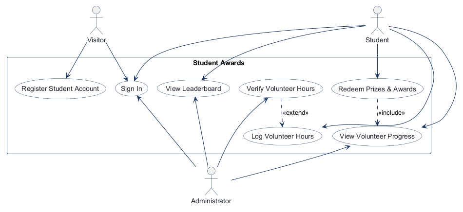
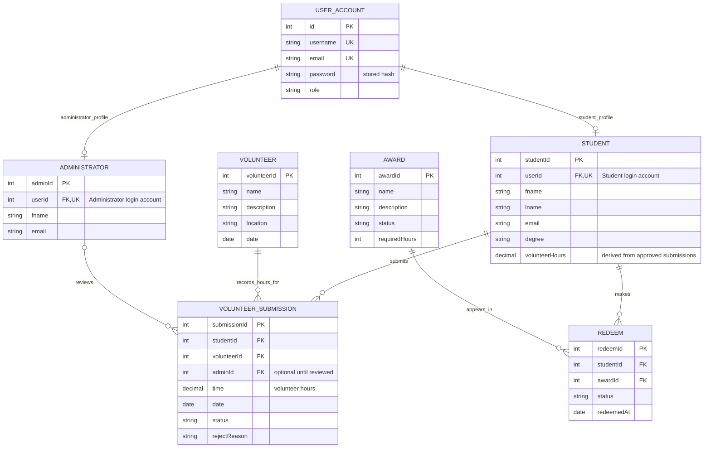
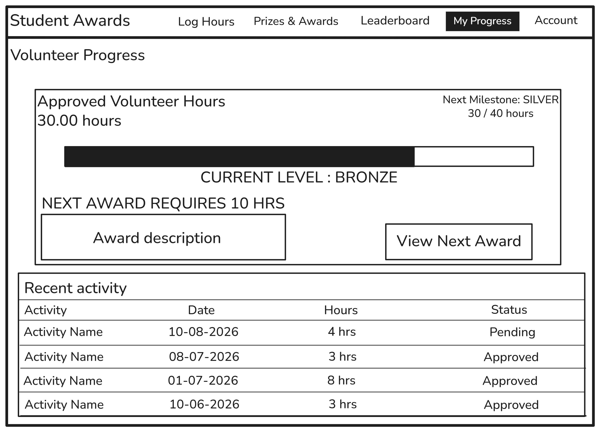
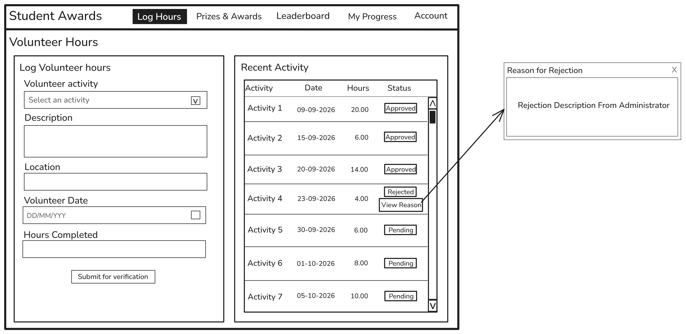
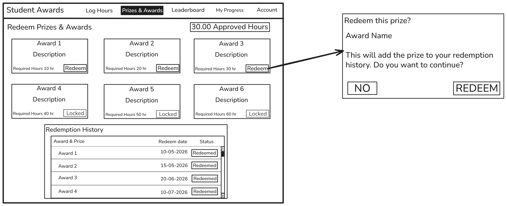
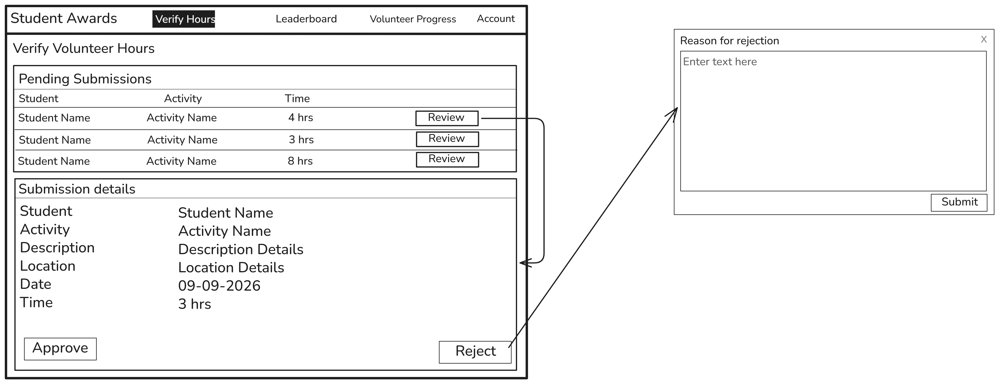
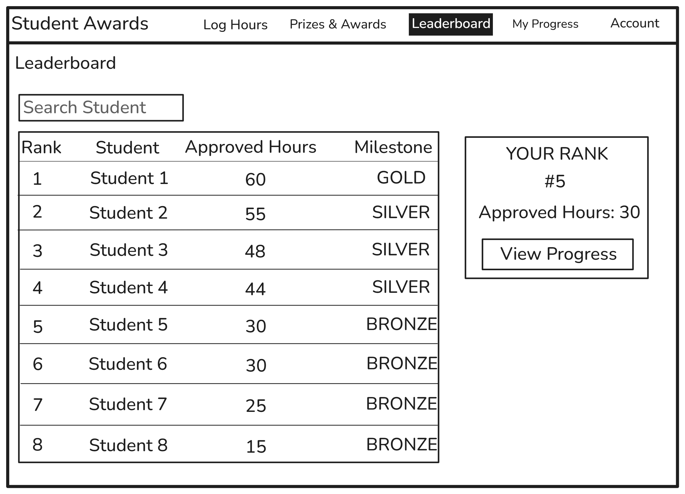

<!-- student-build:skill-integrity
status: pass
root: e84cd692d0b85eefe546385661958c27d07e8be6c5176a82012f68ccff5c8beb
expected_root: e84cd692d0b85eefe546385661958c27d07e8be6c5176a82012f68ccff5c8beb
mismatches: none
-->

# COMP 3613 Assignment 1

Draft this file with the Guide. **Update it after every phase milestone** before you pause. The use-case diagram is a UML PNG at `docs/diagrams/use-case.png`, linked from this file as `diagrams/use-case.png` (path relative to `docs/report.md`). The model diagram is Mermaid. **Embed wireframe images** as `wireframes/<file>` (files live in `docs/wireframes/`).

Do not put your student ID in this file if you will commit it. The PDF cover adds your name and ID at export time.

## Assigned project
Student Awards (incentive system)

## Workflows

### 1. Log Volunteer Hours (Student)

### 2. View Leaderboard (Student)

### 3. View Volunteer Progress (Student and Administrator)

### 4. Redeem Prizes & Awards (Student)

### 5. Verify Volunteer Hours (Administrator)

## Use case diagram

The five numbered items above remain the core student-awards workflows. The implemented use-case diagram also shows the account-entry use cases needed to reach them: visitors can register a Student account, and visitors, Students, and Administrators use the shared sign-in flow. Administrator account provisioning is not public self-registration.

Phase 2 decisions and implementation additions:

- **Redeem Prizes & Awards** includes **View Volunteer Progress**.
- **Verify Volunteer Hours** extends **Log Volunteer Hours**.
- **View Leaderboard** and **View Volunteer Progress** are shared by Students and Administrators; the other use cases are role-specific.
- **Sign In** is shared by visitors and returning Students and Administrators. **Register Student Account** is available to visitors and creates a Student profile; administrator accounts are provisioned separately.
- Administrator student search is included in the **View Volunteer Progress** screen and is not a separate application screen or use case.
- If hours are rejected, the Administrator records a reason. The rejected submission is visible to the Student, who can correct and resubmit it through the existing workflows; no separate follow-up use case is needed.
- During Phase 4, the student removed **Manage Prizes & Awards (Administrator)** from the scope. The Award entity and student redemption workflow remain; this revision removes only the administrator management use case.

## Model diagram

Updated in Phase 5 to include the starter login account entity and its one-to-one role-profile links. The diagram reflects the implemented SQLModel tables; derived totals and role/profile rules are noted below.

Relationship and rule decisions:

- `USER_ACCOUNT` is the starter authentication table (`user` in the database). Its password value is a password hash, never a plaintext password. Each Student or Administrator profile references one unique login account through `userId`; the role determines which profile is required for sign-in. Public registration creates Student accounts only; Administrator accounts are provisioned separately.
- `Student.volunteerHours` is retained as an ERD field, but progress and leaderboard totals are computed from approved `VolunteerSubmission.time` records; the value is not treated as an independently maintained source of truth.
- Each volunteer submission belongs to one Student and one Volunteer activity; each Student and Volunteer can have multiple submissions.
- A submission may have no reviewing Administrator while awaiting review, then records the Administrator who most recently reviews it. Correcting and resubmitting a rejected submission updates that same record.
- Each redemption is a historical transaction for one Student and one Award. Students and Awards can each be associated with multiple redemption records.
- Approved submission hours only count toward progress, award eligibility, and the leaderboard; pending or rejected submissions do not count.

## Wireframes

The updated wireframes for all five in-scope workflows are included below. The uploaded filenames are preserved; `Student_Awards_Log_Hours_Wireframe.png` depicts Volunteer Progress, while `Student_Awards_Volunteer_Activity_Wireframe.png` depicts Log Volunteer Hours. The notes after the images record the remaining differences between the wireframes and implemented screens. Students can select a pre-seeded Volunteer activity or enter an unlisted one, which creates a Volunteer record as part of hour submission. The form includes the Volunteer location.

### Log Volunteer Hours (Student)

<!-- student-build:wireframe-coverage
use_case: Log Volunteer Hours
image: docs/wireframes/Student_Awards_Volunteer_Activity_Wireframe.png
covered: yes
-->

The form shows an activity selector, description, location, date, and hours alongside recent activity and submission status. A rejected item can open a reason-for-rejection dialog. The implemented form also supports entering an unlisted activity; that path is not distinguished from the activity selector in this image.

### View Volunteer Progress (Student and Administrator)

<!-- student-build:wireframe-coverage
use_case: View Volunteer Progress
image: docs/wireframes/Student_Awards_Log_Hours_Wireframe.png
covered: yes
-->

The student dashboard shows approved hours, the next milestone and its progress, a next-award preview, and recent activity. This image does not show the administrator's student search or the student's correction/resubmission controls; those remain implemented states outside this wireframe.

Volunteer levels are derived from approved hours: Bronze below 40 hours, Silver from 40 to under 60 hours, and Gold from 60 hours onward. The next milestone is Silver at 40 hours or Gold at 60 hours; Gold is the highest level.

### Redeem Prizes & Awards (Student)

<!-- student-build:wireframe-coverage
use_case: Redeem Prizes & Awards
image: docs/wireframes/Student_Awards_Redeem_Prizes_Wireframe.png
covered: yes
-->

The screen shows the student's approved hours, award cards, required-hour thresholds, locked/redeem states, a confirmation dialog, and dated redemption history with status. Approved hours determine eligibility and are not deducted by redemption.

### Verify Volunteer Hours (Administrator)

<!-- student-build:wireframe-coverage
use_case: Verify Volunteer Hours
image: docs/wireframes/Student_Awards_Verify_Hours_Wireframe.png
covered: yes
-->

The Administrator can review pending submissions, inspect student and activity details, approve or reject them, and enter a rejection reason. After rejection, the student opens that submission in View Volunteer Progress to see the reason and correct/resubmit the same record for verification.

### View Leaderboard (Student and Administrator)

<!-- student-build:wireframe-coverage
use_case: View Leaderboard
image: docs/wireframes/Student_Awards_Leaderboard_Wireframe.png
covered: yes
-->

The wireframe includes a ranked table, approved-hour totals, a student search field, and a current-rank summary with a View Progress action. The implementation highlights the signed-in student's row and labels it with their username; that specific row treatment is not shown in the image.

### Completed wireframes and documented implementation differences

All five in-scope workflows have completed wireframes, each embedded above and marked covered. Phase 4 is complete; no wireframe authoring or coverage remains outstanding. The notes below document differences between the completed designs and the implemented application, including implemented states that the wireframes do not depict:

- The authenticated navigation in the images shows an “Account” item; the implemented navigation instead shows the signed-in username and role-appropriate links, including Logout.
- The Log Volunteer Hours image does not show the form's progressive disclosure; the app now shows name, description, and location fields only when the student selects an unlisted activity.
- The Volunteer Progress image shows the student dashboard, but not administrator student search or student correction/resubmission controls.
- The Leaderboard image uses sample “Student” labels. The app now includes the image's name/ID search and current-rank panel; it also highlights the signed-in student's row and username badge and shows each student's Bronze/Silver/Gold level, which are not shown in the image.
- The uploaded set covers the five named workflows, not the separate Login and Student Registration screens.

## Theming

Brand: **Student Awards (incentive system)**. Applied a professional scientific style using IBM Plex Sans, deep blue, white, and teal across the landing, login, and registration pages. Replaced FastStarter placeholder branding/copy with volunteer-recognition messaging; the authenticated shell uses the same Student Awards wordmark and palette.

## Account creation and role-based access

Students register with a username, password, and the Student profile fields in the ERD: first name, last name, email, and degree/programme. Registration creates the login account and its one-to-one Student profile together using the account's `userId` foreign key. Administrators do not choose a role at public registration; administrator accounts are provisioned separately and have a one-to-one Administrator profile linked by `userId`.

Students and administrators use the same sign-in screen. After credentials are verified, the application checks the stored role and its corresponding Student or Administrator profile before establishing the login session and routing the user to the appropriate workspace. Missing or unrecognized profile/role configuration is reported and does not create an authenticated session. The seeded administrator account is `admin` / `adminpass`.

## Implementation notes

One named workflow at a time. Include verify notes and polish / model revisions (Phase 5). Do not treat the first build as final.

### Phase 5 implementation checks

Decision: Student and Administrator profiles map one-to-one to starter login accounts through unique `userId` foreign keys. Student registration collects the ERD's first name, last name, email, and degree/programme fields and creates the linked Student profile with the login account. The shared sign-in routes by the stored account role and requires the matching Student or Administrator profile; administrator accounts are provisioned, not self-selected during student registration. Students select from seeded Volunteer activities or enter an unlisted activity; the latter creates a Volunteer record with name, description, location, and date as part of submission.
Phase 5 model revisions: `Volunteer.name` stores the activity label needed by the activity selector. `Award.name` is the displayed award/prize name, `Award.description` supplies its card copy, `Award.requiredHours` sets its approved-hour eligibility threshold, and `Award.status` determines whether it is available. `Redeem.redeemedAt` and `Redeem.status` appear in redemption history.
Volunteer Progress and the Leaderboard derive the Bronze, Silver, and Gold level from approved submission hours using thresholds of 40 and 60 hours; level information is not stored separately.

#### Seeded demonstration data

`python manage.py init` seeds 18 volunteer activities, 15 distinct awards/prizes, 21 leaderboard students, and at least 10 distinct pending volunteer submissions for the administrator review queue. `bob` is shown as Bob Martinez; the other 20 student accounts (`student01` through `student20`) also have realistic sample names. Each student has approved volunteer-hour records with distinct totals for leaderboard ranking. The `bob` demo account has at least 30 approved hours and five eligible prize redemptions in its history. Student accounts use the demo password `studentpass`; existing demo accounts remain `bob` / `bobpass` and `admin` / `adminpass`. The additive seed inserts missing demo data without duplicating existing submissions.

#### Phase 5 workflow implementation update

Implemented app screens and service/repository flows for all five named use cases: students can log hours and track progress, administrators can search students by name or student ID and view their progress, administrators can review pending submissions with a required rejection reason, students can correct and resubmit the same rejected submission, both roles can view the approved-hours leaderboard, and students can redeem eligible awards and view redemption history. Rejected submissions can be edited from either Log Volunteer Hours or Volunteer Progress using a modal for activity selection/details, date, and hours before resubmission. Administrators can open a student's progress from either the leaderboard or the Volunteer Progress student search.

The leaderboard and progress totals use approved submissions only. A redemption records a dated history entry and does not subtract hours from the student's approved total. Account creation and role-based login are described in Account creation and role-based access above. All five wireframes are complete and Phase 4 is met. The implementation differences listed above are documentation of the current app and are not incomplete wireframes. Phase 5 is also complete: the student iteratively checked the app locally, reported concrete behavior and UI mismatches, and steered follow-up implementation and polish across the named workflows. A single final walkthrough of every screen is not required for the Phase 5 exit gate.

<!-- student-build:code-check
workflow: Redeem Prizes & Awards
form: snippet
layer: model
architecture_ok: yes
implement_confidence: 0.68
passed: yes
note: Student aligned Award display name, description, status, and required volunteer-hour threshold, plus Redeem student/award FKs, status, and redemption date.
-->
<!-- student-build:code-check
workflow: Log Volunteer Hours
form: snippet
layer: model
architecture_ok: yes
implement_confidence: 0.68
passed: yes
note: Student aligned submission fields with the ERD, including student/activity FKs, optional reviewing administrator, decimal hours, date, status, and rejection reason.
-->
<!-- student-build:code-check
workflow: Log Volunteer Hours
form: snippet
layer: repository
architecture_ok: yes
implement_confidence: 0.68
passed: yes
note: Student wrote a repository select filtered by Student.userId and returned the optional linked profile; Guide added the supporting activity/submission persistence methods.
-->
<!-- student-build:code-check
workflow: Log Volunteer Hours
form: snippet
layer: router
architecture_ok: yes
implement_confidence: 0.62
passed: partial
note: Student attempted thin GET/POST handlers calling a service; Guide corrected variable/import mismatches and used User.id to resolve the profile.
-->
<!-- student-build:code-check
workflow: Log Volunteer Hours
form: choice
layer: service
architecture_ok: yes
implement_confidence: 0.68
passed: yes
note: Student chose to create an activity record when submitting an unlisted volunteer activity.
-->

<!-- student-build:code-check
workflow: Log Volunteer Hours
form: mcq
layer: other
architecture_ok: no
implement_confidence: 0.55
passed: partial
note: Student initially named a controller; clarified that FastAPI route handlers are the controller-like request boundary and described keeping workflow and persistence logic separate.
-->

<!-- student-build:code-check
workflow: Log Volunteer Hours
form: open
layer: other
architecture_ok: yes
implement_confidence: 0.65
passed: partial
note: Student described request handling separate from validation/business logic and database queries; Guide clarified service/repository roles in this starter.
-->

## Deployed app

Phase 6. Public Render URL (not localhost): **Pending deployment**. After deployment, add the public URL here. Markers will use it to exercise the five named workflows.

Phase 5 is complete, so the project is ready to begin Phase 6. Before exposing the app publicly, replace the fixed seeded administrator credential with a deployment-specific credential and add CSRF protection to authenticated POST actions. Deploy the Render Postgres database and web service, then replace this note with the live URL.

## Logins

Seeded demonstration accounts (all passwords are case-sensitive):

- `bob` / `bobpass` — Student (regular user; Bob Martinez)
- `admin` / `adminpass` — Administrator
- `student01`, `student02`, `student03`, `student04`, `student05`, `student06`, `student07`, `student08`, `student09`, `student10`, `student11`, `student12`, `student13`, `student14`, `student15`, `student16`, `student17`, `student18`, `student19`, `student20` / `studentpass` — Student (20 seeded leaderboard accounts)

The local seed uses the demo administrator password shown above. Before making the application public, provision a deployment-specific administrator password and update this section with the marker credentials.

## YouTube URL

Pending: add the unlisted presentation URL before submission. The video must be at most five minutes and must not show or say the student ID.

## Session transcripts

Filled when the Guide builds the report: the agent writes chat markdown into `docs/transcripts/`; `python manage.py report` packages them.

Guide packaged **4** chat(s) in `docs/transcripts/` (and `docs/transcripts.zip`).

Index: [docs/transcripts/INDEX.md](transcripts/INDEX.md)

- [`copilot-assignment-phases-2026-10-02`](transcripts/copilot-assignment-phases-2026-10-02.md)
- [`copilot-awards-progress-polish-2026-10-06`](transcripts/copilot-awards-progress-polish-2026-10-06.md)
- [`copilot-seed-and-interface-polish-2026-10-05`](transcripts/copilot-seed-and-interface-polish-2026-10-05.md)
- [`copilot-volunteer-workflows-2026-10-05`](transcripts/copilot-volunteer-workflows-2026-10-05.md)

## Competency (student-judge)

Filled by Guide from the student-judge run when this report was built.

**Judged at:** 2026-10-08T21:57:07-04:00
**Evidence pass:** Fresh reassessment of all four accessible Copilot chats, the full current report, all five wireframe coverage blocks, Phase 5 checks, and skill-integrity result. Re-scored each metric against the rubric rather than carrying forward prior totals. Assistant entries in `docs/transcripts/` are concise summaries, not verbatim transcripts.
**Student / session:** Varune Joseph / COMP 3613 Student Awards assignment
**Artifact:** Four Copilot Guide chats and the current assignment artefacts and transcript captures
**Phases in evidence:** 1–6 (COMP 3613; Phase 5 polish, Phase 6 deploy; never generic 0–5)

### Totals

| | Count / value |
|--|--|
| Metrics on rubric | 12 (M1–M12) |
| N/A (excluded) | 0 |
| Metrics scored | 12 |
| Scoreable max | 12 × 4 = 48 |
| Awarded total | 46 / 48 |
| **Overall (avg of scored)** | **3.8 / 4** |
| Impression mark | 19 / 20 |

*No separate Guide confidence value was logged; impression mark is calculated from the overall score.*

## Scorecard

| ID | Metric | Score / 4 | In avg | Evidence |
|----|--------|----------:|:------:|----------|
| M1 | Phase discipline | 4 | yes | The student used separate phase chats, completed design and wireframe work before proceeding to implementation, and continued Phase 5 polish before any deployment. The student’s successive “start phase 2,” “start phase 3,” “start phase 4 wireframe added,” and “start phase 5” prompts track the assignment gates; Phase 5 is met and Phase 6 has not been prematurely started. |
| M2 | Problem framing | 4 | yes | The student defined the Student Awards scope and workflows, engaged with relationships and model choices, and resolved scope questions. Their question “should administrator also have the use case view leaderboard and view volunteer progress?” directly identified shared actor scope; “no use the foreign key user id” is a concrete relationship decision. |
| M3 | Decision ownership | 4 | yes | The student made concrete design and product choices, including “no use the foreign key user id,” “20 additional,” and “as per the wireframes do not remove features,” then corrected mismatches during polish. |
| M4 | Artefact-before-code | 4 | yes | The student explicitly required “ensure the models are implemented as spec in the erd,” later updated and supplied the wireframes, and requested “as per the wireframes do not remove features.” The five completed wireframes and ERD are documented and directly informed implementation and subsequent revisions. |
| M5 | Verification habit | 4 | yes | The student reported observed failures and mismatches—“i am still seeing 30 hours for the mile stone” and “as you can see there is nothing showing up for the milestone on both pages”—and continued steering after fixes. |
| M6 | Assignment fit | 3 | yes | The app and report cover all five named workflows, follow the documented layered design, and show iterative local validation and polish. All five wireframes are complete; Phase 5 is met. |
| M7 | Slice explanation | 3 | yes | The report records student model, repository, and thin-route attempts, including a passing model/repository check and a partial route attempt. The student also made the `userId` relationship choice and clarified workflow behavior. |
| M8 | Prompt quality | 4 | yes | Requests were specific and testable, for example: “if i type ‘b’ as an admin to find a student i would get the option of bob and his lastname,” and asking for an Edit modal that can change and resubmit a rejected hour entry. |
| M9 | Response to pushback | 4 | yes | The student corrected a misunderstood navigation change—“remove the milstone progress from log hours and leave the my progree area”—and continued refining the app after reported mismatches rather than accepting the first build. |
| M10 | Integrity | 4 | yes | No paste-back, laundering, or transcript-gaming signal appeared in the four accessible chats. `skills-verify` passed: all protected skill files match the lockfile. |
| M11 | Provenance continuity | 4 | yes | Across the design, seed/interface, awards, and volunteer-workflow chats, changes remain traceable to the same Student Awards actors, ERD, wireframes, and named workflows. The student explicitly anchored later changes with “as per the wireframes do not remove features” and kept refining those same flows. |
| M12 | Sincerity trajectory | 4 | yes | No suspicion protocol or sincerity blocks were needed across the four chats; the student continued to report concrete app behavior and make corrections. |

## Strengths

- The student consistently followed the assignment’s phase sequence and carried the same design intent across four chats.
- The student repeatedly anchored implementation and refinements to the ERD and completed wireframes.
- The four chats show ongoing ownership of student/admin behavior, seed data, navigation, progress, and rejection-correction workflows.
- The student reported concrete UI and runtime mismatches and steered follow-up fixes.
- Design artefacts and implementation choices stay connected to the Student Awards workflows and ERD.

## Gaps (priority order)

1. **Phase 6 deployment is not complete.** The report has no public deployment URL or marker access details.

## Phase gate status

| Phase | Status | Note |
|-------|--------|------|
| 1 | met | Student Awards and its workflows are recorded before implementation; later student prompts independently describe the named workflows. |
| 2 | met | The use-case diagram records actor sharing and relationships; the student later explicitly asked whether administrators share Leaderboard and Volunteer Progress. |
| 3 | met | The ERD is documented, and the student directly chose the `userId` profile foreign key and participated in model checks. |
| 4 | met | All five in-scope wireframes are complete, embedded, and marked covered in the report. |
| 5 | met | The student iteratively checked local behavior, reported concrete problems, and steered workflow/UI polish after implementation. A single final all-screen walkthrough is not required. |
| 6 | not met | No public deployment URL or marker login details are recorded. |

## Recommended next practice

- Practice explaining one implemented slice end-to-end—for example, how a corrected rejected submission moves through the route, service, and repository—before presenting the deployed app.

## Integrity note

- Clean. Skill-integrity verification passed; no evidence of external-LLM laundering or transcript gaming appeared in the four accessible chats.

## Provenance flags

- None.

## Sincerity log summary

- Blocks found: 0 | max round: N/A | min/mean/final confidence: N/A | trend: N/A | cleared: not applicable

## Skips

- Skips: 0/3 used (no skip declarations found in the four captured chats).

## Skill integrity

Course skills are hashed at export and compared to `.agents/skills.lock.json`. Do not edit `.agents/skills/`, `.cursor/skills/`, or `AGENTS.md`.

- Status: **pass**
- Root: `e84cd692d0b85eefe546385661958c27d07e8be6c5176a82012f68ccff5c8beb`
- none
